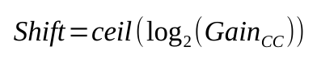
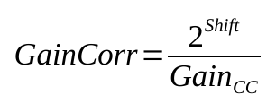
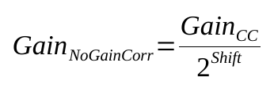
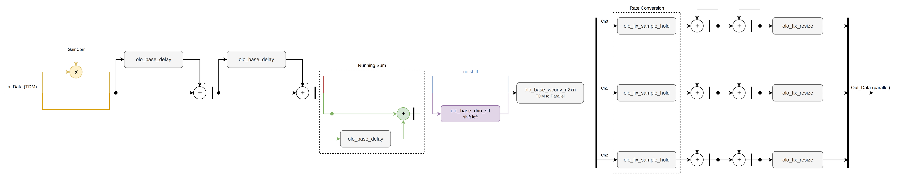

# olo_fix_cic_intp_tdm_par

[Back to **Entity List**](../EntityList.md)

## Status Information

VHDL Source: [olo_fix_cic_intp_tdm_par.vhd](../../src/fix/vhdl/olo_fix_cic_intp_tdm_par.vhd) 
Bit-true Model: [olo_fix_cic_intp.py](../../src/fix/python/olo_fix/olo_fix_cic_intp.py)

## Description

This entity implements a CIC interpolator of configurable order. It takes one or multiple channels time-division
multiplexed (TDM) on the input side and produces all channels in parallel on the output side. The interpolation ratio
can either be runtime configurable or fixed (i.e. compile-time configured).

Because the output side is parallel, the filter can produce one output sample per clock cycle for every channel. So for
all channels the output sample rate can be up to the clock frequency.

For details about the fixed-point number format used in _Open Logic_, refer to the
[fixed point principles](./olo_fix_principles.md).

The modes can be summarized as follows:

- Fixed ratio mode:
  - _FixedRatio_g = true_
  - The configuration ports _Cfg_xxx_ are ignored and can be left unconnected.
  - The CIC filter calculates all shift and gain correction factors internally
- Configurable ratio mode:
  - _FixedRatio_g = false_
  - The user is responsible for applying the correct values to the configuration ports _Cfg_xxx_ (see formulas in
    [Runtime Ratio Configuration](#runtime-ratio-configuration)).
  - The ratio is only allowed to be changed when the CIC is in reset (i.e. _Rst_=1_).

### Flow Control

Every input TDM frame (one sample for each channel) produces _Ratio_ output samples per channel. Hence the input can not
accept one sample per clock cycle in general. The entity signals this using _In_Ready_: The last sample of a TDM frame
is only accepted when at least _Ratio_ clock cycles passed since the last sample of the previous TDM frame was accepted.
All other samples are accepted immediately. As a result, the input frame rate is limited as follows:

- Maximum input frame rate: _Clk_ frequency / max(_Ratio_, _Channels_g_)

For _Channels_g_ >= _Ratio_, _In_Ready_ is never de-asserted (except during reset).

The output side does **not** support back-pressure (there is no _Out_Ready_). Each input TDM frame produces a burst of
_Ratio_ output samples on consecutive clock cycles (with all channels in parallel). If the input frames arrive at
exactly the maximum frame rate, the output is continuous. Otherwise the output is bursty.

If downstream logic requires a constant output sample rate lower than the clock frequency, the output can be smoothed
using [olo_base_fifo_sync](../base/olo_base_fifo_sync.md) followed by
[olo_base_rate_limit](../base/olo_base_rate_limit.md) (_Mode_g_="SMOOTH"). The FIFO is required because
_olo_base_rate_limit_ applies back-pressure which the CIC can not handle. A FIFO depth of _Ratio_ samples is sufficient
as long as the average output rate set by the rate limiter is at least the average rate produced by the CIC (i.e.
_Ratio_ times the input frame rate).

### CIC Gain Handling

CIC interpolators have an inherent gain given by the formula below.

This gain is corrected into the range 0.5 to 1.0 by a bitshift

For _GainCorrCoefFmt_g_ != "NONE", the gain is fine-corrected using a multiplier to exactly 1.0:

If the gain correction is disabled (i.e. _GainCorrCoefFmt_g_ = "NONE"_), the multiplier is bypassed and only the
bitshift is applied to correct the gain into the range 0.5 to 1.0:

For CIC gains that are a power of two, the gain correction can be disabled because the gain is already exactly 1.0
after the bitshift. It is also possible to disable the gain correction for non-power-of-two gains and implement the
fine correction externally.

### Latency

This block does change the sample-rate. Because not every output sample is produced by an input sample, the latency is
not fixed and therefore not documented in detail.

## Generics

| Name              | Type     | Default       | Description                                                  |
| :---------------- | :------- | ------------- | :----------------------------------------------------------- |
| Channels_g        | positive | 1             | Number of channels                                           |
| Order_g           | positive | -             | CIC order   Range 2 ... 32   See [General Architecture](#general-architecture) for the number of stages implemented |
| Ratio_g           | positive | -             | Fixed ratio mode: Interpolation ratio   Configurable ratio mode: Maximum interpolation ratio |
| FixedRatio_g      | boolean  | true          | Implement fixed ratio (true) or configurable ratio (false)   |
| DiffDelay_g       | positive | 1             | Differential delay of comb section (usually 1 or 2)          |
| InFmt_g           | string   | -             | Input data format String representation of an _en_cl_fix Format_t_ |
| OutFmt_g          | string   | -             | Output data format String representation of an _en_cl_fix Format_t_ |
| GainCorrCoefFmt_g | string   | "(0,1,16)"    | Gain correction coefficient format Must be (0,1,x)   String representation of an _en_cl_fix Format_t_.  To disable the internal gain compensation, choose "NONE"   |
| Round_g           | string   | "NonSymPos_s" | Rounding mode String representation of an _en_cl_fix FixRound_t_. |
| Saturate_g        | string   | "Warn_s"      | Saturation mode String representation of an _en_cl_fix FixSaturate_t_. |
| RamBehavior_g     | string   | "RBW"         | Resource control for differentiator delay lines mapped to RAM. Normally not used except for large _Channels_g_ "RBW" = read-before-write, "WBR" = write-before-read For details refer to the description in [olo_base_ram_sdp](../base/olo_base_ram_sdp.md). |
| Resource_g        | string   | "AUTO"        | Resource control for differentiator delay lines. Normally not used except for large _Channels_g_ see [olo_base_delay](../base/olo_base_delay.md) for details |
| RamStyle_g        | string   | "auto"        | Resource control for differentiator delay lines mapped to RAM. Normally not used except for large _Channels_g_ For details refer to the description in [olo_base_ram_sdp](../base/olo_base_ram_sdp.md). |

When gain correction is disabled (i.e. _GainCorrCoefFmt_g_ = "NONE"_), the gain is corrected into the range 0.5 to 1.0
by shifting the output. Only the fine correction to exactly 1.0 using a multiplier is disabled in this case.

## Interfaces

### Control

| Name         | In/Out | Length                     | Default | Description                                                  |
| :----------- | :----- | :------------------------- | ------- | :----------------------------------------------------------- |
| Clk          | in     | 1                          | -       | Clock                                                        |
| Rst          | in     | 1                          | -       | Reset (synchronous, active high)                             |

### Runtime Ratio Configuration

| Name         | In/Out | Length                     | Default | Description                                                  |
| :----------- | :----- | :------------------------- | ------- | :----------------------------------------------------------- |
| Cfg_Ratio    | in     | _log2ceil(Ratio_g)_        | -       | Configured interpolation ratio minus 1 (only used if _FixedRatio_g_=false) Example: _Cfg_Ratio=3_ -> Ratio = 4 |
| Cfg_Shift    | in     | 8                          | -       | Configured bit shift (only used if _FixedRatio_g_=false)  Width is limited to 8 bits |
| Cfg_GainCorr | in     | _width(GainCorrCoefFmt_g)_ | -       | Configured gain correction coefficient (only used if _FixedRatio_g_=false and _GainCorrCoefFmt_g_ /= "NONE") |

These ports are only required for _FixedRatio_g = false_ and can be left unconnected otherwise. The user is
responsible for applying the correct values to these ports. The ratio is only allowed to be changed when the CIC is in
reset (i.e. _Rst_=1_).

The width of _Cfg_Shift_ is fixed to 8 bits for simplicity reasons. In practice, CICs with more than 255 bits of growth
are not practical anyways because they would require too much resources and lead to timing issues. Therefore a fixed
width of 8 bits is sufficient for all sane use-cases.

The formulas for the values to apply are given in section [CIC Gain Handling](#cic-gain-handling). Note that the
interpolator gain formula differs from the decimator gain formula (division by _Ratio_).

### Input Data

| Name     | In/Out | Length            | Default | Description                                                                         |
| :------- | :----- | :---------------- | ------- | :---------------------------------------------------------------------------------- |
| In_Valid | in     | 1                 | '1'     | Input valid                                                                         |
| In_Ready | out    | 1                 | N/A     | Input ready (see [Flow Control](#flow-control))                                     |
| In_Data  | in     | _width(InFmt_g)_  | -       | Input data (TDM)                                                                    |
| In_Last  | in     | 1                 | '0'     | TDM frame boundary (optional) see [TDM Conventions](../Conventions.md#tdm-time-division-multiplexing) |

The signal _In_Last_ is optional and only used to check if the input TDM frame boundaries are correct. Errors are
reported in simulation. The signal is not used for synthesis.

### Output Data

| Name      | In/Out | Length                         | Default | Description                               |
| :-------- | :----- | :----------------------------- | ------- | :---------------------------------------- |
| Out_Valid | out    | 1                              | N/A     | Output valid                              |
| Out_Data  | out    | _width(OutFmt_g)_*_Channels_g_ | N/A     | Output data  Channel-0 = Out_Data\[N-1:0\]   Channel-1 = Out_Data\[2*N-1:N\]   ...  |

## Details

### General Architecture

The architecture of the CIC interpolator is shown in the figure below. Colors denote different implementation
options.

- Blue: _FixedRatio_g = true_ (fixed ratio mode)
- Purple: _FixedRatio_g = false_ (configurable ratio mode)
- Orange: _GainCorrCoefFmt_g_ = "NONE"_ (shift-only gain correction, multiplier bypassed)
- Yellow: _GainCorrCoefFmt_g_ != "NONE"_ (multiplier-based gain correction)
- Red: _DiffDelay_g_ = 1 (running sum bypassed)
- Green: _DiffDelay_g_ > 1 (running sum, shown for _DiffDelay_g_ = 2)

The figure shows _Order_g = 3_ and _Channels_g = 3_.

The gain correction multiplier (if enabled) is implemented at the input on the TDM side, so only one multiplier is
required for all channels. See [Gain Correction](#gain-correction) for details.

The comb (differentiator) stages are implemented on the TDM side, where the sample rate is low. They are shared between
all channels and the delay lines are implemented using _olo_base_delay_ with a depth of _Channels_g_ * _DiffDelay_g_.
The comb stages are implemented at full precision (one bit of growth per stage), so no rounding happens.

The integrators are implemented for each channel separately because they run at the output sample rate (up to one
sample per clock cycle). They are sized for the maximum ratio _Ratio_g_.

Only _Order_g_-1 comb stages and _Order_g_-1 integrators are implemented. The last comb stage, the zero insertion of a
classical CIC interpolator and the first integrator are replaced by a running sum over _DiffDelay_g_ samples (on the
TDM side) followed by a sample and hold (one _olo_fix_sample_hold_ per channel). This is mathematically identical:

- The last comb stage _1 - z-MR_ (in terms of the output sample rate) followed by the first integrator
  _1 / (1 - z-1)_ equals _(1 + z-R + ... + z-(M-1)R) *
  (1 + z-1 + ... + z-(R-1))_.
- The first factor is the running sum over _M_ = _DiffDelay_g_ input samples. For _DiffDelay_g_ = 1 it is a
  pass-through.
- The second factor applied to a zero-stuffed signal equals holding each input sample for _R_ output samples.

The sample and hold is where the sample rate changes (marked as _Rate Conversion_ in the figure): Everything before it
runs at the input sample rate, everything after it at the output sample rate.

The results are bit-true to a classical CIC interpolator. The optimization saves one integrator per channel (running at
the output sample rate) and, for _DiffDelay_g_ = 1, also one comb stage.

The bitshift for gain correction is applied after the integrators. Because the integrators are sized for the maximum
ratio, this shift is a fixed shift by _Shift_ for _Ratio_g_ and hence pure wiring. In configurable ratio mode, the data
is additionally shifted left by the difference between the shift for _Ratio_g_ and _Cfg_Shift_ before the integrators.
This produces exactly the same result as a dynamic right shift after the integrators (no information is lost) but only
requires one dynamic shifter on the TDM side instead of one per channel.

After the shift, the data of each channel is rounded and saturated to the output format according to _Round_g_ and
_Saturate_g_.

The parameters _RamBehavior_g_, _Resource_g_, and _RamStyle_g_ are forwarded to all _olo_base_delay_ instances (comb
stages and running sum). They are important only for cases with enough channels to make usage of RAM (distributed or
block RAM) for the delay lines attractive.

### Gain Correction

The gain correction multiplier is placed at the very input of the CIC (before the comb stages). This allows using one
multiplier for all channels.

Placing the multiplier at the input does not degrade precision: The CIC filter as a whole (comb stages plus integrators)
is an FIR filter, so rounding errors of the multiplier are not accumulated by the integrators. They pass through the
filter like any other input signal (i.e. with a gain of 1.0 after gain correction). Note that it would **not** be
possible to place the multiplier between the comb stages and the integrators because the integrators would accumulate
the rounding errors.

Because the gain correction factor is in the range 1.0 to 2.0, the multiplier output has one more integer bit than
_InFmt_g_. The multiplier output is rounded and saturated according to _Round_g_ and _Saturate_g_ to the format
(_InFmt_g.S_, _InFmt_g.I_+1, min(_OutFmt_g.F_+2, _InFmt_g.F_+_GainCorrCoefFmt_g.F_)). So the multiplier output has
two fractional bits more than _OutFmt_g_ (unless the exact product has fewer fractional bits). This format is used
for the comb stages and integrators.
