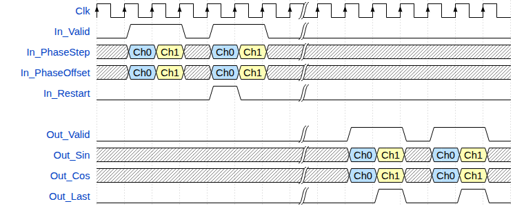
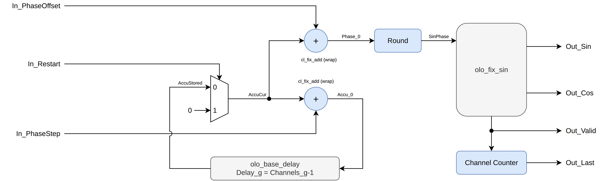

# olo_fix_dds

[Back to **Entity List**](../EntityList.md)

## Status Information


VHDL Source: [olo_fix_dds](../../src/fix/vhdl/olo_fix_dds.vhd)<br />
Bit-true Model: [olo_fix_dds](../../src/fix/python/olo_fix/olo_fix_dds.py)

## Description

This entity implements a **direct digital synthesizer** (DDS) with complex output (sine and cosine). It supports
one or more channels in TDM (time-division-multiplexed) fashion. Each channel has its own phase accumulator, its own
phase step (frequency) and its own phase offset.

For every sample of a channel, the following is calculated:

```text
Phase    = (Accu + Offset) mod 1.00
Out_Sin  = sin(2*pi*Phase) * peak
Out_Cos  = cos(2*pi*Phase) * peak
Accu     = (Accu + Step) mod 1.00   (for the next sample of the same channel)
```

All phases are given in **rotations**, where 0.0 corresponds to 0 degrees and 1.0 corresponds to 360 degrees. The
output frequency of a channel is _Step * Fs_, where _Fs_ is the sample rate of the channel.

The first sample of each channel after reset (or after a restart, see [Restart](#restart)) has the phase _Offset_.

The sine/cosine calculation is done by [olo_fix_sin](./olo_fix_sin.md). The output error stays below **1.5 LSB**
(including the phase rounding described in [Formats](#formats)), so the spectrum has no significant spurs above the
quantization noise floor.

**Latency** of this entity is 14 clock cycles. The entity is fully pipelined, hence it accepts one input sample per
clock cycle. As a result, back-pressure is not supported.

For details about the fixed-point number format used in _Open Logic_, refer to the
[fixed point principles](./olo_fix_principles.md).

The waveform below shows an example with two channels (blue = channel 0, yellow = channel 1). Four samples are
applied (two per channel) with a gap in _In_Valid_ between the two frames. The second sample of channel 0 is restarted,
so its output phase is the phase offset. The outputs appear after the latency of the entity (indicated by the break)
and keep the gap.



### TDM Channel Handling

Phase step, phase offset, restart and the output samples follow the
[TDM Conventions](../Conventions.md#tdm-time-division-multiplexing). The first sample after reset belongs to channel 0.

There is no way to resynchronize the channel order apart from a reset. However, because the reset is fully
synchronous it is completely valid to assert it at any time during normal use to resynchronize the channel order.

_Out_Last_ is asserted together with the output sample of the last channel (_Channels_g_-1). For _Channels_g_=1,
_Out_Last_ is asserted for every sample.

Phase step and phase offset can be changed at runtime at any time. They are applied to the sample they are
supplied with.

## Generics

| Name               | Type     | Default       | Description                                                  |
| :----------------- | :------- | :------------ | :----------------------------------------------------------- |
| Channels_g         | positive | 1             | Number of TDM channels                                       |
| PhaseFmt_g         | string   | -             | Format of phase step, phase offset and accumulator (in rotations). Must be `(0, 0, M)`. |
| OutFmt_g           | string   | -             | Output Format, one of the formats supported by [olo_fix_sin](./olo_fix_sin.md) <br> `(1, 0, 10..20)` or `(1, 1, 10..20)`. |
| Round_g            | string   | "NonSymPos_s" | Rounding mode of the sine/cosine output stage                |
| SinMemStyle_g      | string   | "auto"        | Resource control for the sine table. Applied to the ROM attributes _rom_style_, _romstyle_ and _syn_romstyle_.<br />For values refer to _MemStyle_g_ in [olo_fix_coef_storage](./olo_fix_coef_storage.md#generics) |
| DelayResource_g    | string   | "AUTO"        | Resource control for the accumulator storage (_AUTO_, _SRL_ or _BRAM_). <br />See [olo_base_delay](../base/olo_base_delay.md) |
| DelayRamBehavior_g | string   | "RBW"         | RAM behavior of the accumulator storage (only relevant if BRAM is used). <br />See [olo_base_delay](../base/olo_base_delay.md) |
| DelayRamStyle_g    | string   | "auto"        | RAM style of the accumulator storage (only relevant if BRAM is used). <br />See [olo_base_delay](../base/olo_base_delay.md) |

## Interfaces

### Control

| Name | In/Out | Length | Default | Description                                     |
| :--- | :----- | :----- | ------- | :---------------------------------------------- |
| Clk  | in     | 1      | -       | Clock                                           |
| Rst  | in     | 1      | -       | Reset input (high-active, synchronous to _Clk_) |

### Input Data

| Name           | In/Out | Length              | Default | Description                                                      |
| :------------- | :----- | :------------------ | ------- | :--------------------------------------------------------------- |
| In_Valid       | in     | 1                   | '1'     | AXI4-Stream handshaking signal for all input signals             |
| In_PhaseStep   | in     | _width(PhaseFmt_g)_ | -       | Phase step per sample in rotations (TDM)<br />Format: _PhaseFmt_g_ |
| In_PhaseOffset | in     | _width(PhaseFmt_g)_ | -       | Phase offset in rotations (TDM)<br />Format: _PhaseFmt_g_        |
| In_Restart     | in     | 1                   | '0'     | Restart the channel (TDM). See [Restart](#restart)               |

### Output Data

| Name      | In/Out | Length            | Default | Description                                                         |
| :-------- | :----- | :---------------- | ------- | :------------------------------------------------------------------ |
| Out_Valid | out    | 1                 | N/A     | AXI4-Stream handshaking signal for _Out_Sin_, _Out_Cos_ and _Out_Last_ |
| Out_Sin   | out    | _width(OutFmt_g)_ | N/A     | Sine output (TDM)<br />Format: _OutFmt_g_                           |
| Out_Cos   | out    | _width(OutFmt_g)_ | N/A     | Cosine output (TDM)<br />Format: _OutFmt_g_                         |
| Out_Last  | out    | 1                 | N/A     | TDM frame boundary, asserted on the last channel (_Channels_g_-1)<br />see [TDM Conventions](../Conventions.md#tdm-time-division-multiplexing) |

## Details

### Architecture

The phase accumulators of all channels are stored in a delay line ([olo_base_delay](../base/olo_base_delay.md))
which, together with the accumulator register, has a length of exactly _Channels_g_ samples. Hence the accumulator
value that leaves the delay line always belongs to the channel that is currently processed. Depending on the number
of channels the delay line is implemented in registers, SRLs or BRAM.

[olo_base_delay](../base/olo_base_delay.md) is used with _RstState_g_=true. It outputs zeros until it has been filled
completely after a reset, so all accumulators start at zero even if they are stored in BRAM (which cannot be reset).



The architecture consists of the following stages:

1. **Phase accumulation:** If _In_Restart_ is asserted, the stored accumulator is replaced by zero. The phase step and
   the phase offset are added to the accumulator by two separate, registered, wrapping adders. The sum with the
   phase step is fed back into the delay line, the sum with the phase offset is the output phase.
2. **Phase rounding:** The output phase is rounded to the input format of _olo_fix_sin_ (wrapping, so a phase that
   rounds up to 1.0 becomes 0.0).
3. **Sine/Cosine:** [olo_fix_sin](./olo_fix_sin.md) calculates sine and cosine (12 clock cycles).

_Out_Last_ is derived from a counter that counts the output samples. Because the pipeline does not change the order
of samples, this counter always matches the channel of the output sample.

### Restart

When _In_Restart_ is asserted for a sample, the accumulator of the corresponding channel is set to zero before it is
used. Hence the output phase of this sample is the phase offset and the channel restarts its waveform. This
allows producing 100% reproducible output sequences. Other channels are not affected.

After a reset, the accumulators of all channels are zero.

### Formats

_PhaseFmt_g_ is used for the phase step, the phase offset and the accumulator. It must be of the form `(0, 0, M)`,
because the phase covers exactly one rotation. The frequency resolution is _Fs / 2^M_. A typical choice is
`(0, 0, 32)`.

_OutFmt_g_ must be `(1, 0, N)` or `(1, 1, N)` with _N_ between 10 and 20, as for [olo_fix_sin](./olo_fix_sin.md).
Without integer bit the wave is scaled to a peak of 1.0 - 1 LSB, with integer bit it is unscaled (peak 1.0).
The output can never overflow, so no saturation is implemented (for any rounding mode).

The accumulated phase is rounded to `(0, 0, min(M, N+3))` before it is applied to _olo_fix_sin_. This keeps the
error caused by phase quantization below half an LSB of the output while keeping the multiplier inside
_olo_fix_sin_ small. The accumulator itself always runs at the full resolution of _PhaseFmt_g_, so the frequency
resolution is not affected by the rounding.
