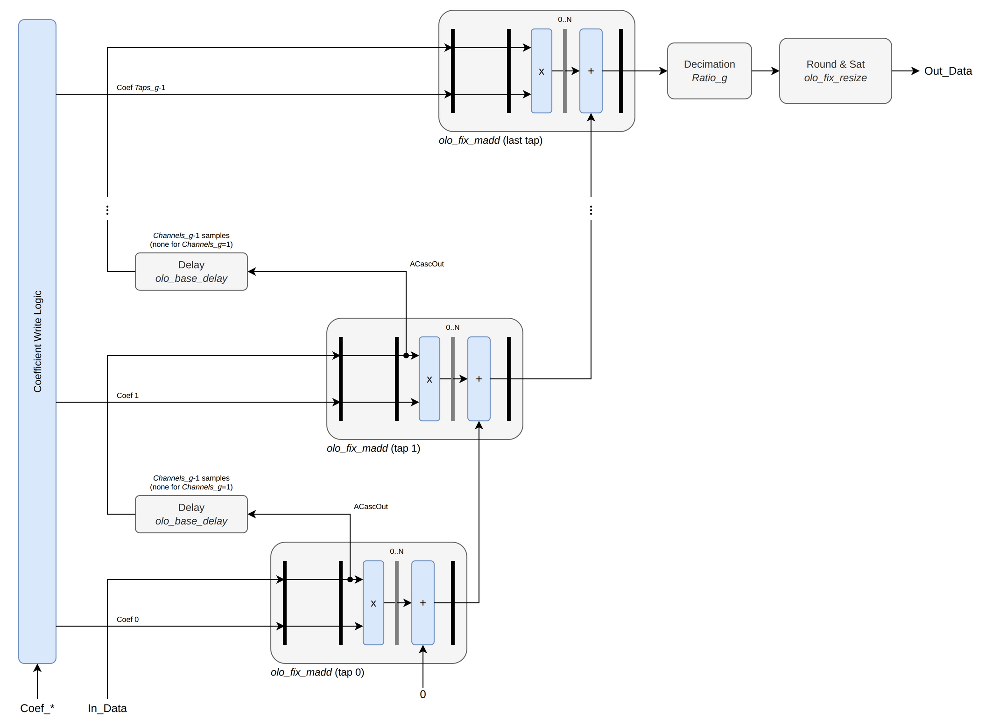
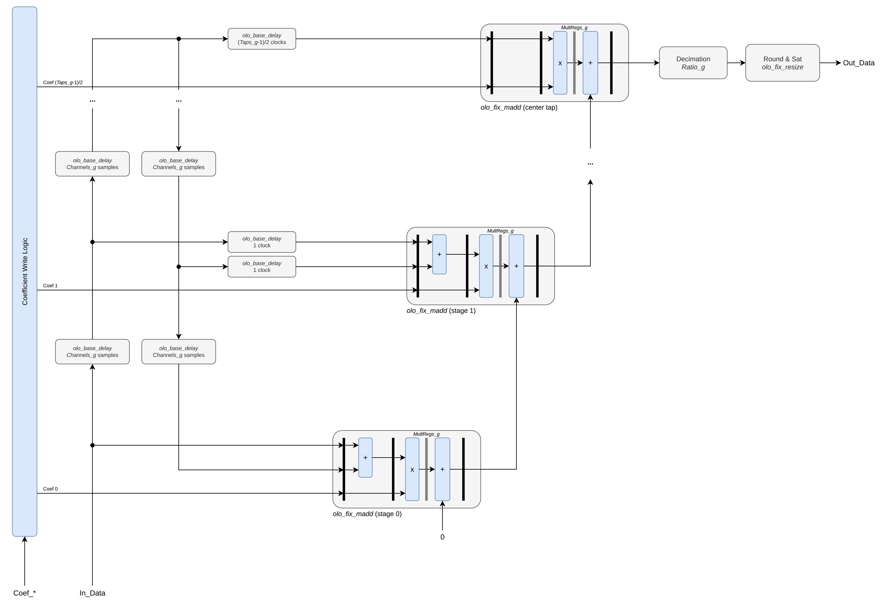

# olo_fix_fir_dec_par_chtdm

[Back to **Entity List**](../EntityList.md)

## Status Information


VHDL Source: [olo_fix_fir_dec_par_chtdm.vhd](../../src/fix/vhdl/olo_fix_fir_dec_par_chtdm.vhd)<br />
Bit-true Model: [olo_fix_fir_dec.py](../../src/fix/python/olo_fix/olo_fix_fir_dec.py)

## Description

This entity implements a FIR filter for one or more TDM (time-division-multiplexed) channels. All channels share the
same coefficients. The filter taps are computed _fully parallel_: Each tap has its own multiplier and all multipliers
are chained in a MACC (multiply-accumulate) chain that maps onto the cascade paths of DSP blocks.

As a result, the filter accepts one input sample on every clock cycle, independently of the number of taps and
channels. It never generates backpressure and no rate limiting is required.

A single channel (_Channels_g = 1_) is supported as well.

The filter can decimate (_Ratio_g > 1_) by dropping output samples. This does not save any multipliers, because all
taps are computed for all samples. [olo_fix_fir_dec_semi_chtdm](./olo_fix_fir_dec_semi_chtdm.md) saves multipliers
but depending on configuration may consume more logic.

For details about the fixed-point number format used in _Open Logic_, refer to the
[fixed point principles](./olo_fix_principles.md).

### Latency

The latency from _In_Valid_ to _Out_Valid_ is _Taps_g + MultRegs_g + 4_ clock cycles.

For _IsSymmetric_g = true_, the latency is _ceil(Taps_g/2) + MultRegs_g + 4_ clock cycles.

For _Ratio_g > 1_, this applies to the input samples for which an output sample is produced. The first frame after
reset and every _Ratio_g_-th frame after it produce an output sample.

## Generics

| Name              | Type     | Default    | Description                                                   |
| :---------------- | :------- | :--------- | :------------------------------------------------------------ |
| InFmt_g           | string   | -          | Input format<br>String representation of an _en\_cl\_fix FixFormat\_t_ |
| OutFmt_g          | string   | -          | Output format<br>String representation of an _en\_cl\_fix FixFormat\_t_ |
| CoefFmt_g         | string   | -          | Coefficient format<br>String representation of an _en\_cl\_fix FixFormat\_t_ |
| Channels_g        | positive | 1          | Number of TDM channels (>= 1; single- or multi-channel)       |
| Ratio_g           | positive | 1          | Decimation ratio (one output per _Ratio_g_ input sample sets) |
| Taps_g            | positive | -          | Number of filter taps (must be >= 2)                          |
| IsSymmetric_g     | boolean  | false      | _false_ - No assumption about the coefficients, one multiplier per tap<br>_true_ - Coefficients are symmetric, one multiplier per pair of taps. See [Symmetric Coefficients](#symmetric-coefficients). |
| GuardBits_g       | natural  | 1          | Number of integer guard bits in the accumulator above _OutFmt_g_ |
| Round_g           | string   | "Trunc\_s" | Rounding mode<br>String representation of an _en\_cl\_fix FixRound\_t_ |
| Saturate_g        | string   | "Warn\_s"  | Saturation mode<br>String representation of an _en\_cl\_fix FixSaturate\_t_ |
| MultRegs_g        | positive | 1          | Number of pipeline registers in each multiplier               |
| CoefInit_g        | string   | "0.0"      | Comma-separated coefficient values (real numbers, quantized to _CoefFmt_g_)<br>Taps without a value are set to zero<br>Example: "0.3, 0.55, 0.2" |
| CoefWritable_g    | boolean  | false      | _false_ - Coefficients are fixed to _CoefInit_g_.<br>_true_ - Coefficients can be written at runtime. See [Coefficients](#coefficients). |
| DataRamBehavior_g | string   | "RBW"      | Data RAM behavior: "RBW" = read-before-write, "WBR" = write-before-read<br>Only relevant for delay lines implemented in block RAM (large _Channels_g_)<br>See [olo_base_delay](../base/olo_base_delay.md) |
| DataMemStyle_g    | string   | "auto"     | Synthesis attribute for the delay line memory style<br>See [olo_base_delay](../base/olo_base_delay.md) |

## Interfaces

### Control

| Name | In/Out | Length | Default | Description                      |
| :--- | :----- | :----- | :------ | :------------------------------- |
| Clk  | in     | 1      | -       | Clock                            |
| Rst  | in     | 1      | -       | Reset (synchronous, active high) |

### Coefficient Configuration

| Name         | In/Out | Length             | Default | Description                                         |
| :----------- | :----- | :----------------- | :------ | :-------------------------------------------------- |
| Coef\_Addr   | in     | _log2ceil(Taps_g)_ | 0       | Coefficient address<br>Address 0 is the coefficient applied to the newest input sample (first value in _CoefInit_g_), address _Taps_g-1_ the one applied to the oldest sample<br>Writes above _Taps_g-1_ are ignored<br>For _IsSymmetric_g = true_, writes above _ceil(Taps_g/2)-1_ are ignored |
| Coef\_WrEna  | in     | 1                  | '0'     | Coefficient write enable                            |
| Coef\_WrData | in     | _width(CoefFmt_g)_ | 0       | Coefficient write data                              |

All _Coef\_*_ ports are only used for _CoefWritable_g = true_ and can be left unconnected otherwise.

There is intentionally no coefficient readback. It would prevent mapping the coefficients into the input registers of
DSP blocks, which cannot be read back.

### Input Data

| Name     | In/Out | Length           | Default | Description                                                                        |
| :------- | :----- | :--------------- | :------ | :--------------------------------------------------------------------------------- |
| In_Valid | in     | 1                | -       | Input valid                                                                        |
| In_Data  | in     | _width(InFmt_g)_ | -       | Input data (TDM: channels interleaved, ch0 first)                                  |
| In_Last  | in     | 1                | '0'     | TDM frame boundary (optional)<br>see [TDM Conventions](../Conventions.md#tdm-time-division-multiplexing) |

### Output Data

| Name      | In/Out | Length            | Default | Description                                                                        |
| :-------- | :----- | :---------------- | :------ | :--------------------------------------------------------------------------------- |
| Out_Valid | out    | 1                 | N/A     | Output valid                                                                       |
| Out_Data  | out    | _width(OutFmt_g)_ | N/A     | Output data (TDM: channels interleaved, ch0 first)                                 |
| Out_Last  | out    | 1                 | N/A     | TDM frame boundary, asserted on the last channel<br>see [TDM Conventions](../Conventions.md#tdm-time-division-multiplexing) |

## Details

### Example Instantiation

The example below shows a simple instantiation of a two channel filter with fixed coefficients and no decimation. The
coefficient configuration ports and _In_Last_ are omitted.

```vhdl
i_fir : entity olo.olo_fix_fir_dec_par_chtdm
    generic map (
        InFmt_g    => "(1,0,15)",
        OutFmt_g   => "(1,0,15)",
        CoefFmt_g  => "(1,0,17)",
        Channels_g => 2,
        Taps_g     => 4,
        CoefInit_g => "0.1, 0.4, 0.4, 0.1"
    )
    port map (
        Clk       => Clk,
        Rst       => Rst,
        In_Valid  => In_Valid,
        In_Data   => In_Data,
        Out_Valid => Out_Valid,
        Out_Data  => Out_Data
    );
```

### Architecture

The datapath consists of _Taps_g_ [olo_fix_madd](./olo_fix_madd.md) stages using the A cascade (_ACascade_g = true_).



For _Channels_g > 1_, an [olo_base_delay](../base/olo_base_delay.md) adds the
remaining _Channels_g - 1_ samples, so that each stage sees the sample of the same channel one sampling period earlier.
For Channels_g = 1, this delay is not required and omitted.

For _Channels_g = 1_, the delay between stages can use the dedicated data cascade of the DSP blocks. For
_Channels_g > 1_, the data must leave the DSP blocks to pass through the delay line, so noticeably more logic registers
are required per tap.

The sum of the last stage is decimated, then rounded and saturated to _OutFmt_g_ using
[olo_fix_resize](./olo_fix_resize.md).

### Symmetric Coefficients

Linear-phase FIR filters have symmetric coefficients: Coefficient _i_ equals coefficient _Taps_g-1-i_. For
_IsSymmetric_g = true_, this property is exploited to compute both taps with one multiplier. As a result, a filter with
_Taps_g_ taps only requires _ceil(Taps_g/2)_ multipliers. Even and odd values of _Taps_g_ are supported.



The delay line is folded: All samples pass through one chain of _Taps_g-1_ [olo_base_delay](../base/olo_base_delay.md)
instances of _Channels_g_ samples each. Each stage adds the two samples sharing a coefficient in the pre-adder of its
[olo_fix_madd](./olo_fix_madd.md). Because stage _i_ is _i_ clock cycles late due to the registers in the adder chain,
its two samples pass through a delay of _i_ clock cycles first.

The figure shows an odd number of taps, where the center tap has no partner. It is computed by a stage without
pre-adder but with the same latency. For an even number of taps, there are two center taps and they form a normal pair
in the last stage. The two ends of the delay line are then connected through one more delay of _Channels_g_ samples.

The output is bit-true to a filter with _IsSymmetric_g = false_ and the same coefficients. The pre-adder does not lose
any bits, it has one integer bit more than _InFmt_g_. This must be taken into account for mapping to DSP blocks: The
pre-adder output must fit the multiplier input (e.g. 25 bits, hence _InFmt_g_ up to 24 bits).

The savings in multipliers come at the cost of logic for the delays that align the samples. The two delays of stage _i_
take _2 * i_ registers per bit. For long filters, this is a noticeable amount of logic, which however maps to SRLs on
devices that support them.

The coefficients are handled as follows:

- For _CoefWritable_g = false_, _CoefInit_g_ must contain all _Taps_g_ coefficients. After quantization to _CoefFmt_g_
  they must be symmetric, otherwise an assertion fires in simulation.
- For _CoefWritable_g = true_, only the lower half of the coefficients including the center tap(s) is stored
  (addresses _0_ to _ceil(Taps_g/2)-1_). Writes to the upper half and values in the upper half of _CoefInit_g_ are
  ignored, no assertion fires for them.

### Coefficients

For _CoefWritable_g = false_, the coefficients are constants given by _CoefInit_g_. Synthesis tools may optimize the
multipliers according to the coefficient values.

Taps with a coefficient that is zero after quantization to _CoefFmt_g_ do not contain a multiplier for
_CoefWritable_g = false_. They only contain the registers required to keep the timing, so latency and behavior do not
change. This saves DSP blocks for filters with many zero coefficients (e.g. half-band filters).

For _CoefWritable_g = true_, each coefficient is stored in the input B registers of its
[olo_fix_madd](./olo_fix_madd.md) stage:

_Rst_ loads the values from _CoefInit_g_ as long as no coefficient was written. Hence _Rst_ must be asserted before
the filter is used and before the first coefficient is written.

For _IsSymmetric_g = true_, there is one coefficient per stage. See [Symmetric Coefficients](#symmetric-coefficients).

**Coefficients must only be written while no calculation is ongoing**, which means that no samples are applied to the
input and no output samples are outstanding. The entity does not synchronize coefficient updates to the data, so a
write during operation leads to output samples computed from a mix of old and new coefficients.

### Reset

_Rst_ clears the delay lines, which are built from registers and [olo_base_delay](../base/olo_base_delay.md). Unlike
[olo_fix_fir_dec_semi_chtdm](./olo_fix_fir_dec_semi_chtdm.md), no flushing is required after a reset. The output after
a reset is bit-true to the Python model, which initializes its delay line to zero.

### Accumulator Format

The adder chain operates in _AccuFmt_, which keeps all fractional bits of the multiplier results:

- _AccuFmt = (1, Out.I + GuardBits_g, MultFmt.F)_
- _MultFmt = cl_fix_mult_fmt(InFmt_g, CoefFmt_g)_

_GuardBits_g_ integer guard bits above _OutFmt_g_ allow the result to exceed the output range, so that it can be
saturated correctly. With the default of one guard bit, results of up to twice the _OutFmt_g_ maximum are supported.
The user is responsible for choosing _GuardBits_g_, the coefficients and the formats accordingly. Otherwise the
result wraps.

Intermediate sums in the adder chain may wrap, as this does not affect the final result. Only the final result must
fit into _AccuFmt_.

The adder chain only maps to the cascade paths of DSP blocks if _AccuFmt_ is not wider than the DSP block adder (e.g.
48 bits for many AMD devices). Otherwise it is implemented in logic, which is much more expensive.

### Last Handling

On the input, _In_Last_ is not required for operation. It is only used in simulation to detect incorrect TDM framing:
an error is reported if _In_Last_ is asserted on a sample that does not belong to the last channel (_Channels_g-1_). It
has no functional effect on the computation.

On the output, _Out_Last_ is generated by the entity itself and is always asserted together with _Out_Valid_ on the
last channel (_Channels_g-1_) of every output sample set.
