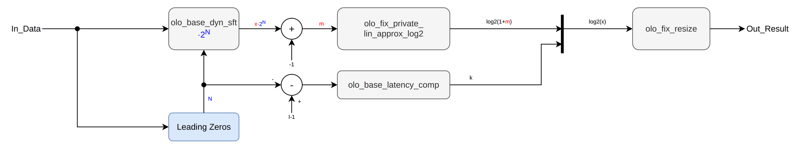

# olo_fix_log2

[Back to **Entity List**](../EntityList.md)

## Status Information


VHDL Source: [olo_fix_log2](../../src/fix/vhdl/olo_fix_log2.vhd)<br />
Bit-true Model: [olo_fix_log2](../../src/fix/python/olo_fix/olo_fix_log2.py)

## Description

This entity calculates the binary logarithm of the input:

```text
Out_Result = log2(In_Data)
```

The input is normalized into the range `[1, 2)` by a left shift, so that `In_Data = 2^k * (1+m)` with the mantissa
fraction `m` in `[0, 1)`. The logarithm is then split into two parts:

```text
log2(In_Data) = k + log2(1+m)
```

- The **integer part** _k_ is given by the position of the leading one of the input (leading zero detection).
- The **fractional part** `log2(1+m)` is calculated through a table based piecewise linear approximation. It covers
  `[0, 1)`.

Because the integer part is a two's complement number and the fractional part is a positive fraction, the two parts are
simply concatenated, which is pure wiring.

The normalization covers the full input range, so the approximation only has to cover one octave. Hence a
relatively small table delivers accurate results over the full range of any input format. The precision of the
approximation is derived from the fractional bits of _OutFmt_g_, see [Precision](#precision).

### Other Logarithms

The entity can be used to calculate a logarithm of any base by scaling its result with a constant factor (e.g. using
[olo_fix_mult](./olo_fix_mult.md)):

```text
logb(x) = log2(x) * logb(2)
```

Common examples:

| Function                      | Scaling factor of _Out_Result_ |
| ----------------------------- | ------------------------------ |
| `log10(x)`                    | 0.30103                        |
| `ln(x)`                       | 0.693147                       |
| Power in dB `10*log10(x)`     | 3.0103                         |
| Amplitude in dB `20*log10(x)` | 6.0206                         |

Note that the error of the result is scaled by the same factor.

### Corner Cases

The logarithm is only defined for positive numbers, hence the input format must be **unsigned** (`(0, X, Y)`)

An input of **zero** delivers the same result as the smallest non-zero input (`-InFmt_g.F`), which is the smallest
result the entity can produce. No error is flagged.

Results are **negative** for inputs below 1.0. If _OutFmt_g_ is unsigned, they are handled by _Saturate_g_ (with the
default "Sat_s" they saturate to zero). It is the responsibility of the user to choose a signed output format if
negative results are required.

### Latency

Latency is not guaranteed to be constant across different versions. It's therefore best to design user logic to be
independent of the latency of this block (e.g. through [olo_base_latency_comp](../base/olo_base_latency_comp.md)).

In the current version the latency is 17 clock cycles, independently of the input format. If the approximation is
omitted, the latency is 6 clock cycles (see [Omitted Approximation](#omitted-approximation)).

## Generics

| Name       | Type   | Default       | Description                                                  |
| :--------- | :----- | :------------ | :----------------------------------------------------------- |
| OutFmt_g   | string | -             | Output fixed-point format. <br> must have at maximum 20 fractional bits  |
| InFmt_g    | string | -             | Input fixed-point format. Must be unsigned and at least two and at most 256 bits wide. |
| MemStyle_g | string | "auto"        | Resource control for the table. Applied to the ROM attributes _rom_style_, _romstyle_ and _syn_romstyle_.<br>For values refer to _MemStyle_g_ in [olo_fix_coef_storage](./olo_fix_coef_storage.md#generics) |
| Round_g    | string | "NonSymPos_s" | Rounding mode of the output stage                            |
| Saturate_g | string | "Sat_s"       | Saturation mode of the output stage                          |

## Interfaces

### Control

| Name | In/Out | Length | Default | Description                                     |
| :--- | :----- | :----- | ------- | :---------------------------------------------- |
| Clk  | in     | 1      | -       | Clock                                           |
| Rst  | in     | 1      | -       | Reset input (high-active, synchronous to _Clk_) |

### Input Data

| Name     | In/Out | Length           | Default | Description                                  |
| :------- | :----- | :--------------- | ------- | :------------------------------------------- |
| In_Valid | in     | 1                | '1'     | AXI4-Stream handshaking signal for _In_Data_ |
| In_Data  | in     | _width(InFmt_g)_ | -       | Input data<br />Format: _InFmt_g_            |

### Output Data

| Name       | In/Out | Length            | Default | Description                                         |
| :--------- | :----- | :---------------- | ------- | :-------------------------------------------------- |
| Out_Valid  | out    | 1                 | N/A     | AXI4-Stream handshaking signal for _Out_Result_     |
| Out_Result | out    | _width(OutFmt_g)_ | N/A     | Binary logarithm of _In_Data_<br />Format: _OutFmt_g_ |

## Details

### Architecture

The figure below shows the architecture of the entity.



The number of leading zeros _N_ of the input is determined, and the input is normalized by shifting it left by _N_
using [olo_base_dyn_sft](../base/olo_base_dyn_sft.md), which spreads the barrel shifter over two pipeline stages to
achieve good timing. The integer part of the result is calculated from _N_ (`I-1-N` for an input format with _I_
integer bits) and delayed to the output of the approximation by
[olo_base_latency_comp](../base/olo_base_latency_comp.md).

The leading one of the normalized value `1+m` is known, hence it is removed (dropping the bit is the same as the
subtraction of 1 shown in the figure) and only the **mantissa fraction** _m_ in the range `[0, 1)` is passed on. The
function approximated is `log2(1+m)`, which covers the range `[0, 1)`. As a result the whole range of the approximation
is used.

The approximation is implemented by the internal entity _olo_fix_private_lin_approx_log2_. It contains the logarithm
tables (one per supported precision) and instantiates
[olo_fix_lin_approx_calc](./olo_fix_lin_approx_calc.md) for the piecewise linear interpolation.

The integer part (signed, just wide enough to cover `-InFmt_g.F ... InFmt_g.I-1`) and the fractional part are
concatenated into a number with as many fractional bits as the selected table delivers (see [Precision](#precision)).
Finally the result is rounded/saturated to _OutFmt_g_ by [olo_fix_resize](./olo_fix_resize.md).

### Omitted Approximation

For some configurations without fractional output bits, the fractional part of the logarithm cannot affect the result.
In this case the the approximation (including its table and multiplier) is not implemented. The result is calculated
from the number of leading zeros only and is bit-true to the result
with the approximation. The latency is reduced to 6 clock cycles.

| Fractional bits of _OutFmt_g_ | _Round_g_     | Approximation |
| ----------------------------- | ------------- | ------------- |
| 0 or less                     | "Trunc_s"     | omitted       |
| less than 0                   | "NonSymPos_s" | omitted       |
| 0                             | "NonSymPos_s" | required      |
| any                           | other modes   | required      |

Note that the approximation is required for 0 fractional bits with "NonSymPos_s" because the fractional part decides
whether the result is rounded up. The other rounding modes treat ties specially, which also depends on the fractional
part.

### Precision

One table exists per supported precision. The entity automatically selects the smallest table that delivers at least
the number of fractional bits of _OutFmt_g_. More than 20 fractional bits lead to an error:

| Fractional bits of _OutFmt_g_ | Precision of the approximation | Table size    |
| ----------------------------- | ------------------------------ | ------------- |
| up to 10                      | 10 bits                        | 32 x 18 bit   |
| 11 to 14                      | 14 bits                        | 128 x 23 bit  |
| 15 to 18                      | 18 bits                        | 512 x 30 bit  |
| 19 to 20                      | 20 bits                        | 1024 x 33 bit |

Because the normalization makes the accuracy independent of the magnitude of the input, the error is defined as an
**absolute** error. The approximation stays within +/-1.5 LSB of an output with _PrecisionBits_g_ fractional bits.
